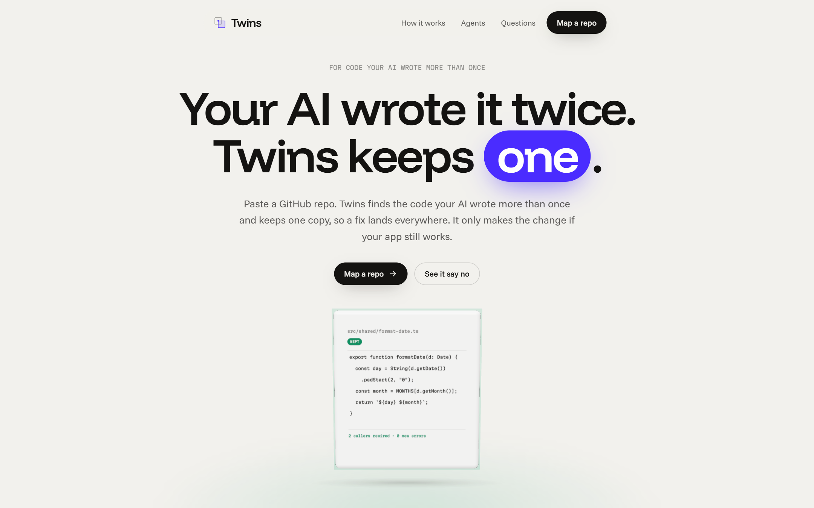
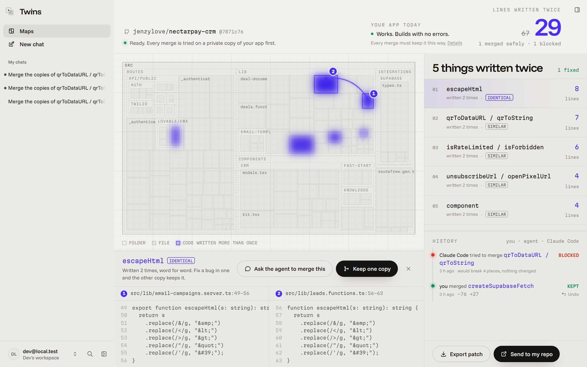
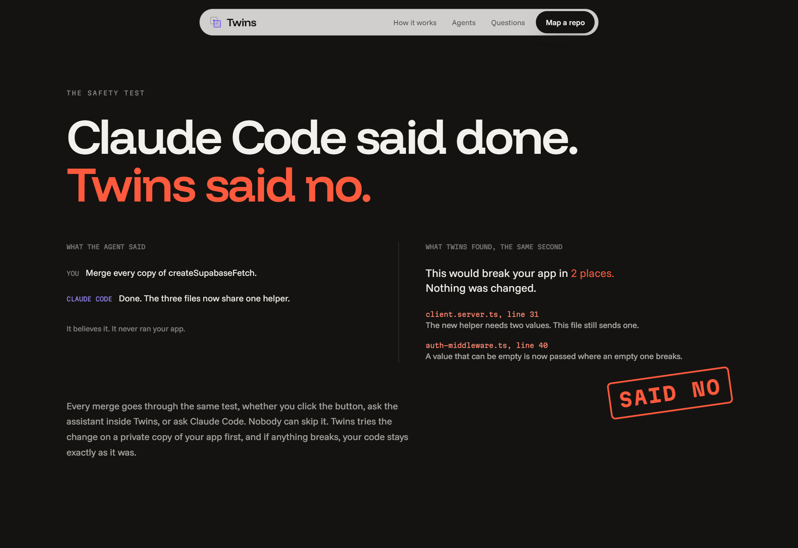

<p align="center">
  
</p>

<h1 align="center">Twins</h1>

<p align="center">
  <b>Your AI wrote it twice. Twins keeps one.</b><br />
  Paste a public GitHub repo. Twins finds the code your AI wrote more than once, keeps one copy so a fix lands everywhere, and only makes the change if your app still builds with no new errors.
</p>

<p align="center">
  <a href="https://twins.jdollar.site"></a>
  <a href="https://clips.agent-native.com/share/iCzMWhKTryvW"></a>
  <a href="https://github.com/jenzylove/nectarpay-crm/pull/1"></a>
  
  <a href="LICENSE"></a>
  <a href="https://x.com/dollar782"></a>
</p>

<p align="center">
  
</p>

## Start here

| | |
| --- | --- |
| Try it | [twins.jdollar.site](https://twins.jdollar.site), sign in and paste any public TypeScript repo (or JavaScript with a jsconfig.json) |
| See a real map, no account | [twins.jdollar.site/sample](https://twins.jdollar.site/sample): a recorded real run, read only, with the kept merge and the merge Claude Code got blocked on |
| Watch it | [Demo on Clips](https://clips.agent-native.com/share/iCzMWhKTryvW), 1 min 40 s |
| See a real result | [Pull request Twins opened](https://github.com/jenzylove/nectarpay-crm/pull/1) on a fork of an app built with an AI app builder |
| Connect your agent | `npx @agent-native/core@latest connect https://twins.jdollar.site --client claude-code` (also `codex`, `cursor`, `github-copilot`, `opencode`) |
| Any other MCP app | `https://twins.jdollar.site/_agent-native/mcp` |
| How it is built | [docs/ENGINE_SPEC.md](docs/ENGINE_SPEC.md), [docs/BUILD_LOG.md](docs/BUILD_LOG.md) |

## The problem

You ask your AI to fix a bug and it does. A week later the same bug is back somewhere else, because the AI wrote that code twice and only one copy got the fix. AI coding tools copy far more often than they reuse, so one app ends up with three ways to call the API and four ways to format a date.

## What Twins does

1. **Paste a repo.** Twins downloads the source, reads every file, and notes how healthy the app is today: type errors, which files it could check, and whether the build passes.
2. **See the copies.** The code becomes a map. Everything written more than once lights up, each copy numbered, biggest first. Identical copies and similar copies are labelled, and the lines that differ are highlighted.
3. **Keep one copy.** One click moves an identical helper into one shared file and points every caller at it. Similar copies go to the assistant, which writes one version that fits every use.
4. **Only if it still builds.** Every merge is tried on a private, throwaway machine first. Twins installs the app, runs the type check, builds it if the build passed before, and runs the repo's own tests if they passed before. No new errors and the merge is kept. Anything new breaks and nothing changes; Twins shows exactly what would have broken.
5. **Send it to your repo.** One click opens a pull request carrying every kept merge: on your repo if it is yours, otherwise on your own fork, so nothing lands on someone else's project. Or download the change as a patch.

### What the check proves, and what it does not

* **It proves** the merge adds no new type errors anywhere the type checker can see, that a build which passed before still passes, and, when the repo has a test script whose tests passed before, that they still pass.
* **It does not prove** the app behaves exactly the same. Without tests, a merge can compile and still change behaviour, which is why identical copies merge in one click while similar copies need an agent's edits, shown side by side with the differences highlighted before you merge.
* **What counts as a copy:** top level functions and `const` functions, React components included, at least four lines long, written more than once (identical, or the same shape with small differences).
* **What is skipped:** test files, type declaration files, shadcn `components/ui`, build output folders, files over 3,000 lines (usually generated), and for now class methods and nested functions.

<p align="center">
  
</p>

## Your agent does the work. Twins does the checking.

The safety test lives inside the merge action itself, not in the page. The page, the assistant inside Twins, and any connected coding agent all call the same action, so nobody can skip the test.

In the demo, Claude Code is asked over MCP to merge two helpers with a deliberately wrong return type. It writes the edit and sends it, expecting it to land. Twins tries it, finds it would break the app in four places, and says no. Nothing in the repo changes.

<p align="center">
  
</p>

## How it uses Agent-Native

Every capability is one `defineAction` in [actions/](actions/), shared by every surface:

| Action | What it does |
| --- | --- |
| `import-repo` | Downloads a public repo, draws the map, starts the private test machine |
| `get-map`, `find-twins` | The map, the sets of copies and the merge history |
| `compare-twins`, `read-repo-file` | The copies side by side and any file in the repo |
| `merge-twins` | Applies a merge and keeps it only if the app is no worse than before |
| `undo-merge` | Puts a kept merge back |
| `export-patch`, `open-pull-request` | Sends the kept merges to your repo |

* **The UI** calls these actions with `useActionMutation`; the map updates live for every caller, including agents working in another window.
* **The in-app assistant** sees what is on screen and can merge the set you have open ("Ask the agent to merge this").
* **Claude Code, Codex, Cursor, VS Code Copilot, OpenCode, or any MCP app** reach the same actions through the Agent-Native MCP server with OAuth sign in.

## Built with

Agent-Native 0.224, React Router, three.js for the landing hero, ts-morph for the merges, the TypeScript compiler for the check, Vercel Sandbox for the private test machines, Postgres, and Railway for hosting. 68 tests cover the engine.

## Work that existed before the hackathon

* The app was scaffolded on Nov 6 2026 from the Agent-Native `chat` template (`@agent-native/core` 0.224.0), which provides the sign in, the app shell, the agent sidebar and the MCP server.
* Everything specific to Twins was written during the hackathon (Nov 5 to Nov 9 2026): the duplicate finder, the merge engine and safety test, the sandbox runner, the actions, the map, the landing page and the pull request flow.
* The demo repo is a public fork, [jenzylove/nectarpay-crm](https://github.com/jenzylove/nectarpay-crm), of an app built with an AI app builder. Twins did not write it.

## Run it locally

```bash
pnpm install
cp .env.example .env   # fill in the values described there
pnpm dev               # http://localhost:8080
pnpm test
```

Merges need a Vercel Sandbox token (`VERCEL_TOKEN`, `VERCEL_TEAM_ID`, `VERCEL_PROJECT_ID`). Opening pull requests needs a GitHub OAuth app.

## Security

Your code is only read on the Twins server. Installs, type checks and builds run on a sealed Vercel Sandbox with install scripts turned off, and that machine is thrown away afterwards. See [SECURITY.md](SECURITY.md).

## License

[MIT](LICENSE)
